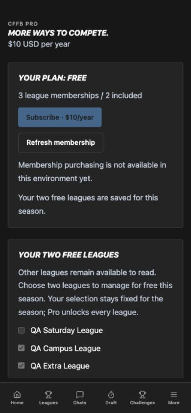
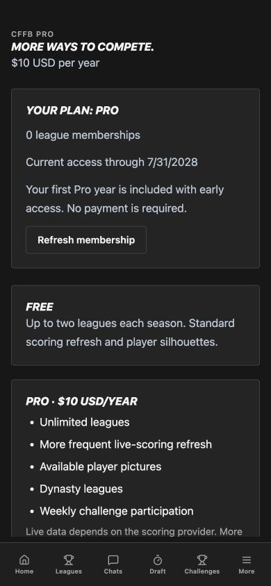

# Annual membership verification — October 27, 2026

Verdict: **PASS** for local implementation and regression checks.
**Actual provider purchase certification remains pending configuration.**

## Scope and isolation

Worktree `annual-membership`, branch `codex/annual-membership`, based on dynasty
PR #425 (`71433257b35939882e677bfe962a1cacdd3c6f3c`). Membership remains off by
default. No production migration, charge, merge, deployment or App Store release
was performed. The ordinary draft interface is preserved.

## Contract and automated verification

- Full backend regression: **1405 passed, 9 skipped**. Tests that require a live
  provider or PostgreSQL skip in the default SQLite run. An initial invocation
  omitted `PYTHONPATH=.` and failed two subprocess import checks; the complete
  suite passed after correcting the invocation, without changing those scripts.
- Final affected membership/dynasty/challenge API suites: **96 passed, 4 skipped**.
  Includes unpaid dynasty and Saturday Pick 6 writes, expired dynasty read access,
  five weekly formats, stale/refunded subscriptions, account ownership and images.
- Final provider-contract regression run: **22 passed, 1 skipped**, including
  dispute-created/revoked access and dispute-won restoration using Stripe's
  charge-filtered Dispute list contract.
- Disposable PostgreSQL 16 membership suite: **20 passed**, including concurrent
  requests for the last free slot. Final deletion/tombstone and slot tests rerun:
  **2 passed**. Two simultaneous free joins produce one 200 and one 402 and retain
  exactly two committed memberships.
- Actual Stripe SDK webhook signature verification rejects invalid HMACs.
  Provider resource calls use mocked authority; invalid Apple JWS is tested
  against the actual official verifier. Valid provider renewals/refunds are
  mocked at the official verifier boundary, with an autospecced notification test.
- Existing full React suite: **712 passed in 107 files**. New membership tests:
  **9 passed**. Final membership/challenge UI run: **22 passed**. One pre-existing
  slate test timed out while the full backend suite was competing for CPU; it
  passed on rerun. App/test/Vite type checks and production web build pass.
- Native Xcode iOS simulator Debug build passes for the StoreKit 2 bridge,
  including the final web assets. No signing, installation or store submission.
- New migrations upgrade from 0126 through 0128, backfill an existing account,
  produce zero model drift, downgrade/re-upgrade, and preserve representative
  redraft/dynasty rows. PostgreSQL ownership FKs set deleted owners to NULL.
  Downgrade after that deletion correctly refuses to fabricate an old owner.

Contracts inspected on both sides: membership status/capabilities, typed free
league selection, owned checkout/portal URLs, verified Apple receipt input,
401/402/409/422/503 failures and optional matchup viewer-refresh fields. No URL
query or client state grants Pro. Failed native verification never finishes a
receipt; pending/cancelled purchases never show success. Native clients never
fall back to web checkout.

## Browser verification

Environment: CUA in-app browser; React Vite at `127.0.0.1:4179`, FastAPI at
`127.0.0.1:8548`, disposable PostgreSQL at port 55468. Frontend/API runtime
identities use the same base SHA. Fictional `example.com` accounts and a synthetic
2027 clock were injected only by an external `/private/tmp` QA launcher. Purchases
were disabled and no provider keys or actual payment sessions were used.

Verification contract: `/membership` must show $10/year and the server plan,
disable purchase without provider readiness, preserve two free leagues, show the
included early-access year, and avoid false paid-success messages or overflow.

- Free account: visible Free plan, three retained memberships, two selected free
  leagues and disabled Subscribe. Changed the pair through checkboxes and clicked
  Save. The API persisted the new pair, the success message appeared and further
  rotation controls became disabled for the season. No Pro success appeared.
- Signed out and signed in as a different fictional early-access user through
  the normal login form. The page showed Pro and the included first-year message,
  verified paid-through date and no Subscribe button. Free-account choices did
  not leak into this account.
- Desktop 1280×900 and mobile 390×844 verified by DOM and accessibility state.
  Document scroll width equalled viewport width at both breakpoints. Mobile
  controls stayed readable/reachable. The temporary viewport override was reset.
- Screenshots below use fictional QA data. Wide evidence is the 900px responsive
  breakpoint; the in-app screenshot surface clips wider emulated viewports.

[Wide membership view](images/membership-free-wide.png)

## Remaining launch work

Configure actual Stripe and App Store products/keys/notifications and execute the
provider test-mode/Sandbox/TestFlight matrix in the
[launch runbook](../operations/annual-membership.md). Simulator compilation and
mocked provider calls do not prove real checkout, renewal, refund or restore.
Set the reviewed 2027 launch timestamp and release the signed native build only
after certification. Dynasty scoring-season integration remains separately gated.
