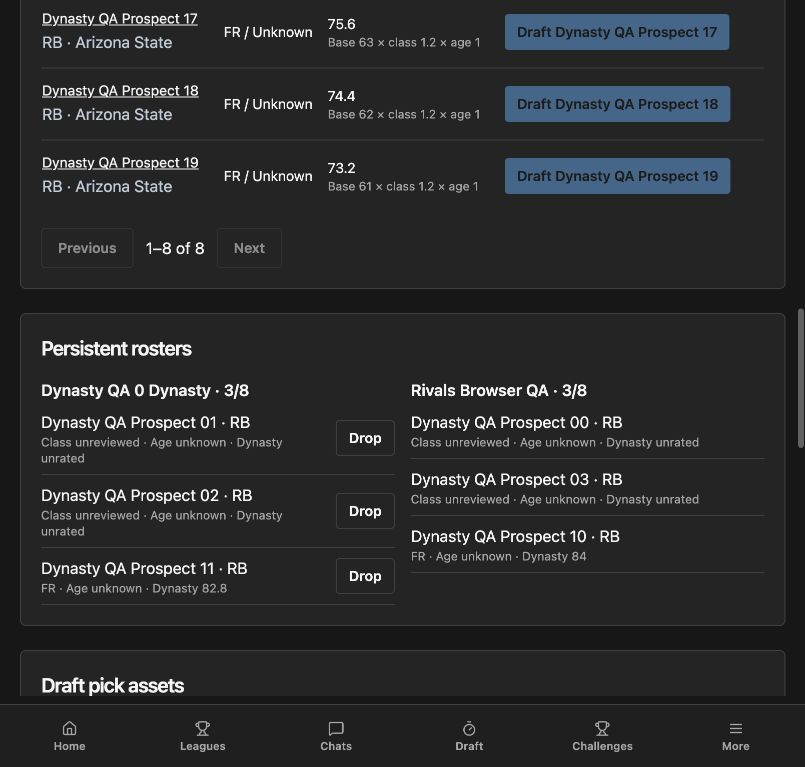

# Dynasty preview verification — October 27, 2026

Verdict: **PASS for the isolated draft/roster preview scope.** This is not a
scoring-season certification or a 2027 release authorization.

## Environment and scope

- Branch `codex/dynasty-2027`, based on the deployed Week 8 correction release.
- FastAPI at `http://127.0.0.1:8547`, Vite at `http://127.0.0.1:4177`.
- Separate managers at localhost and 127.0.0.1 origins; CUA in-app browser.
- PostgreSQL 16 bound to loopback in a disposable Docker container. Synthetic
  accounts, prospects and evidence URLs only. No production API or database writes.
- Disabled frontend comparison at `http://127.0.0.1:4178/labs/dynasty`.

## Browser evidence

1. Signed in through the real local auth API and created a 2027 league using
   the preview form. Second manager joined using the invite code.
2. Startup order materialized as Rivals → Commissioner. Selections advanced
   Rivals → Commissioner → Commissioner → Rivals, proving snake reversal.
   Each roster contained two selected players at completion.
3. Commissioner proposed a 2028 first-round pick exchange; recipient accepted.
   Each asset retained the original franchise name after changing ownership.
4. Commissioner reviewed 3–7 and 7–3 regular-season records, runner-up/champion
   finishes, closed 2027 and opened 2028. Both rosters retained two players.
   Round-one order became runner-up → champion.
5. Pool contained only reviewed 2028 first-entry freshmen. The first pick belonged
   to Rivals but originated with Commissioner; the acquired owner selected.
   Both teams finished the freshman draft with three players.
6. 2027 archive preserved four rostered players and the submitted final records.
7. Reload preserved completed draft and rosters. Current reviewed freshman values
   appeared; players missing 2028 facts stayed rostered with class unreviewed,
   age unknown and dynasty unrated. No inference from old class or missing data.
8. Disabled frontend route displayed the ordinary 404 page. Normal league
   creation retained its four-step redraft setup with no dynasty option.
   No recruiting-class-rights option appeared in preview.
9. Browser console had no warnings/errors after the verified workflow. Found and
   corrected the initial empty trade-partner state after a new manager joined;
   added a regression test.

## Automated verification

- Final dynasty SQLite contract tests: **8 passed, 1 skipped**. The skipped test
  explicitly requires PostgreSQL row locking.
- Final dynasty PostgreSQL tests: **9 passed**, including simultaneous distinct
  selections for one pick, competing trade acceptances, stale/cross-league assets,
  ownership, capacity, rollover retention and reviewed freshman eligibility.
- Broad backend run: **1,382 passed, 8 skipped**, plus two failures at socket bind
  because the sandbox denied loopback sockets. Both local-port tests passed
  when rerun with socket permission. Final dynasty edits were verified again
  by the targeted SQLite/PostgreSQL suites above.
- Full frontend suite: **705 passed in 105 files**. A first run timed out in an
  existing weekly-challenge test under parallel build/backend load; isolated
  rerun and the complete rerun both passed.
- Final dynasty UI regression suite: **5 passed** (includes the newly added join
  regression), all app/test/Vite TypeScript checks and production build passed.
- Final migration: upgrade from 0125 to 0126, no drift, downgrade to 0125,
  re-upgrade, no drift. Specifically identified existing 2026 league, team,
  roster and raw/current player value sentinel rows survived unchanged.
- Bruno request files cover every preview endpoint. Bruno CLI was unavailable;
  the collection itself was not executed. Actual HTTP contracts were exercised
  through API tests and the browser workflow.

Remaining launch gates are in the [requirements](../../requirements/28_epic_dynasty_2027.md)
and [operator guide](../operations/dynasty-preview.md). No merge or deployment.
