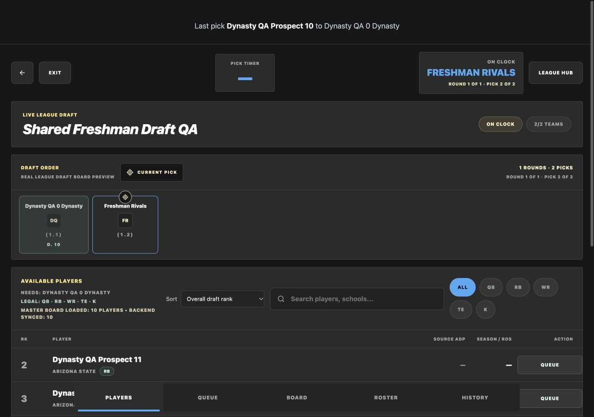

# Shared dynasty draft UI verification — October 27, 2026

Verdict: **PASS** for the user's correction: use the normal draft interface.

`DynastyDraft` renders the existing `Draft.tsx` with a dynasty data adapter.
No duplicate draft layout, stylesheet, table or pick control remains on the
management dashboard. Normal drafts keep their original source by default.
The existing API's dynasty pool remains the eligibility authority; the annual
board contains incoming freshmen, while startup uses all reviewed eligible players.

## Browser verification

CUA in-app browser, Vite `127.0.0.1:4177`, API `127.0.0.1:8547`, and a
disposable PostgreSQL 16 database. Fictional QA players/accounts only.

- `/labs/dynasty/2/draft`: normal header, draft order cards, player rows, search,
  sort, positions, queue, board, roster/history tabs and pick confirmation.
- Annual board: ten reviewed 2028 first-entry freshmen; no 2027 returning
  players in the available player list. Missing projections appear as dashes.
- Search narrowed to a single freshman without changing his board rank.
- Roster tab retained both previously drafted players before freshman picks.
- Both managers selected through the existing Draft buttons. Confirmation,
  next owner, board history and normal completion dialog advanced correctly.
- View Your Roster returned to `/labs/dynasty?league=2`; both rosters had three
  players. The dashboard had zero tables or alternate drafting controls.
- `/labs/dynasty/1/draft`: same normal UI, two startup rounds and all ten
  eligible returning players. Queue and board tabs worked through normal controls.
- Desktop 1280×900 and mobile 390×844 checked. Mobile document width and scroll
  width both 390px; player actions and all tabs remained reachable. Temporary
  viewport override reset after verification.
- Browser logged the existing React Router v7 future warnings; no application
  errors. Production and the 2026 application were not changed or deployed.

[Mobile evidence](images/dynasty-normal-draft-mobile.png)

## Contract and regression checks

- SQLite dynasty plus existing normal draft API tests: 45 passed, 1 skipped.
- PostgreSQL dynasty contracts/concurrency: 10 passed.
- Full frontend suite: **712 passed in 107 files**. Shared-screen tests cover untimed
  pick submission, unchanged timed expiry protection and two acquired picks in
  one round without board-cell loss.
- All app/test/Vite type checks and the production build passed.

The adapter preserves server selection history after a player is dropped and
keeps complete-board ranks stable after picks. Cache namespaces, mutation URLs,
player-card league context and completion exits remain isolated from regular
leagues. The preview uses a dash in the existing timer slot; it does not invent
deadlines or change regular draft timers.

See [requirements](../../requirements/28_epic_dynasty_2027.md) and
[preview launch gates](../operations/dynasty-preview.md). PR #425 stays draft,
unmerged and undeployed to production.
